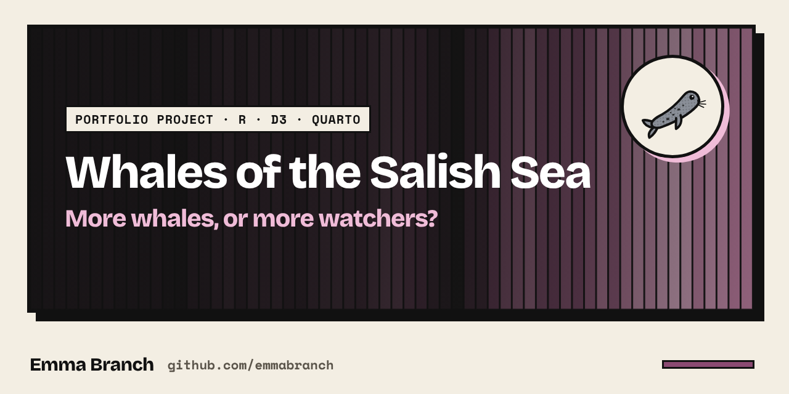
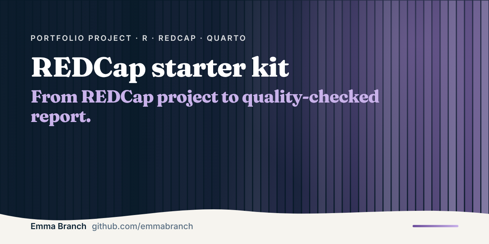
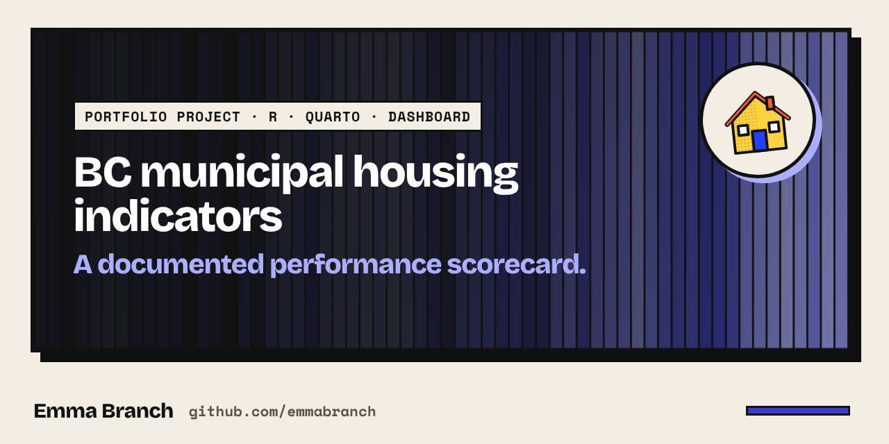
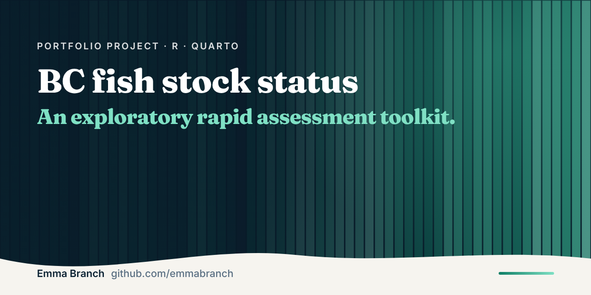
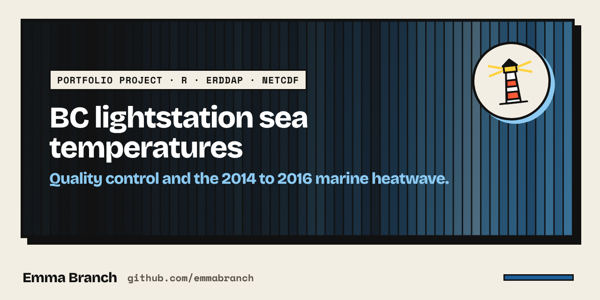
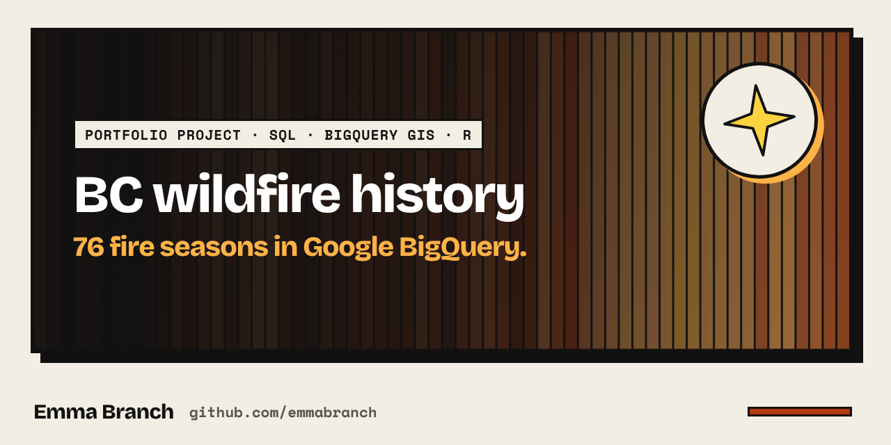
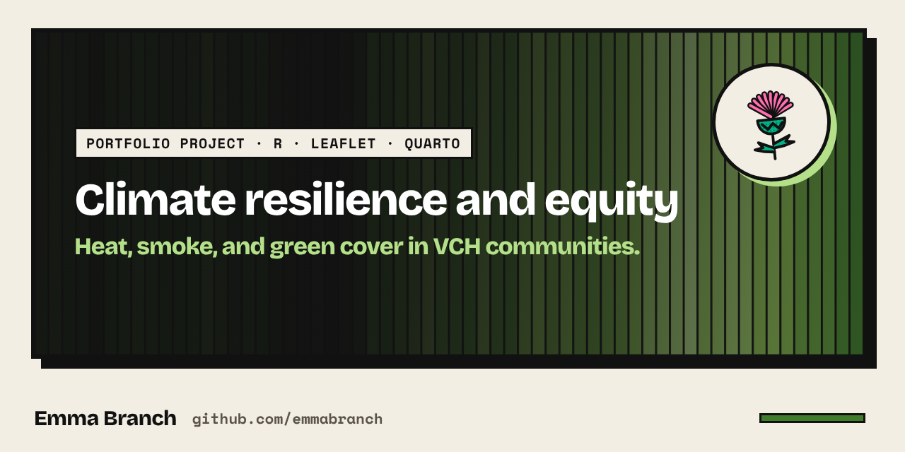
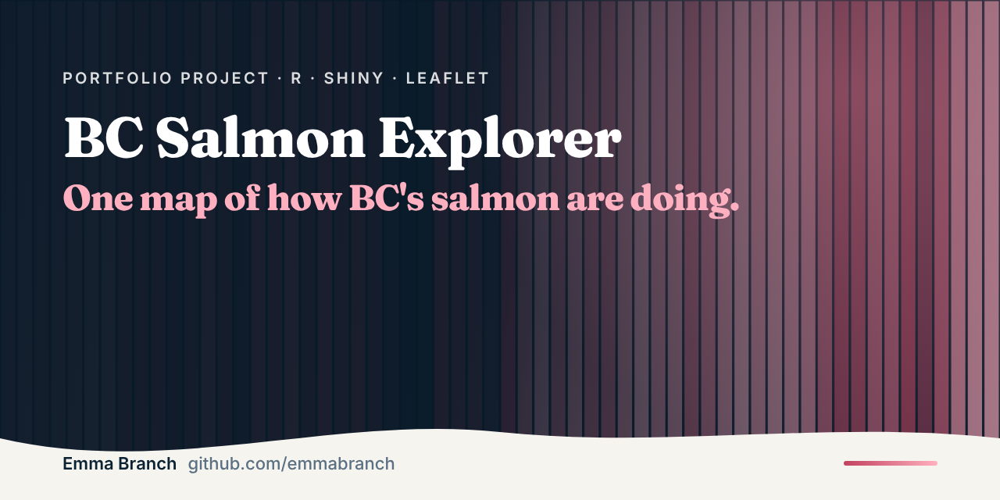
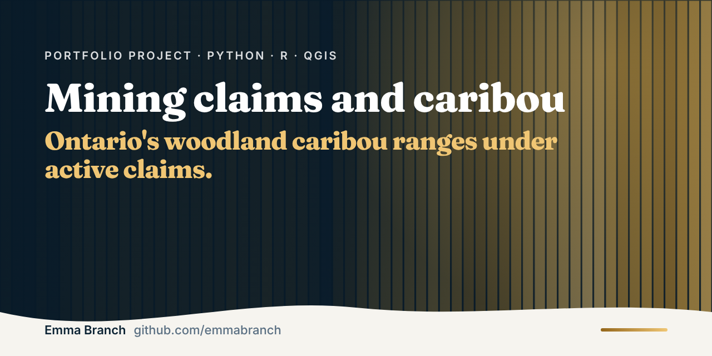
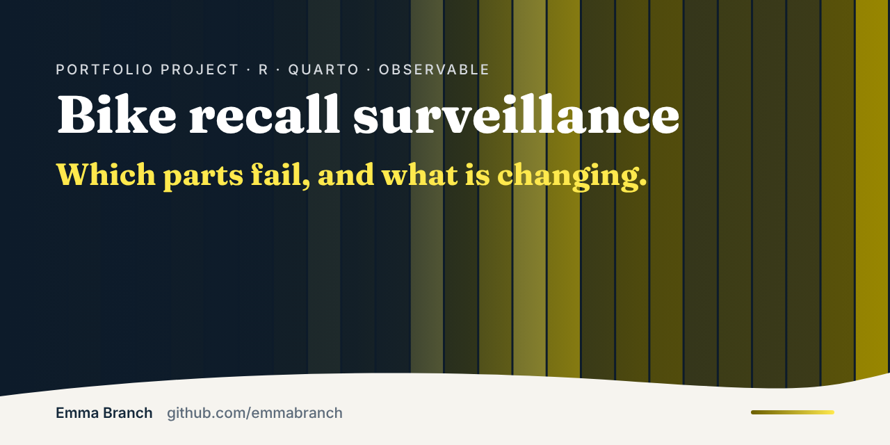

# Hi, I'm Emma Branch 👋

I'm an epidemiologist and data analyst in British Columbia, and a PhD candidate in Population and Public Health at the University of British Columbia. My research looks at wildfire smoke exposure and perinatal and infant health. I've spent about 10 years working with health research data, including registry analytics, REDCap database design, data governance, and performance measurement. I like turning complex data into clear evidence that public health teams, planners, and communities can act on. Lately I've been applying the same skills to ocean, wildlife, and fisheries data and to housing indicators, with a focus on documented, reproducible workflows, clear performance reporting, and interactive data stories.

**Interests:** environmental and climate health, ocean and fisheries data, housing and health equity, performance measurement, spatial epidemiology, data storytelling, and knowledge translation.

## Portfolio projects

<table>
<tr>
<td width="50%" valign="top">

<b><a href="https://emmabranch.github.io/salish-sea-whales/">Whales of the Salish Sea</a></b> More whales, or more watchers? An interactive story about 13,000 whale sightings.

<i>R · D3 · Quarto closeread</i> <a href="https://emmabranch.github.io/salish-sea-whales/">Live site</a> · <a href="https://github.com/emmabranch/salish-sea-whales">Code</a>

</td>
<td width="50%" valign="top">

<b><a href="https://emmabranch.github.io/redcap-starter-kit/">REDCap starter kit</a></b> From REDCap project to quality-checked report, with dictionary-driven cleaning and six data quality checks.

<i>R · REDCap · Quarto</i> <a href="https://emmabranch.github.io/redcap-starter-kit/">Live site</a> · <a href="https://github.com/emmabranch/redcap-starter-kit">Code</a>

</td>
</tr>
<tr>
<td width="50%" valign="top">

<b><a href="https://emmabranch.github.io/bc-housing-indicators/">BC municipal housing indicators</a></b> A documented red, amber, and green scorecard for the 40 municipalities with housing targets.

<i>R · Quarto dashboard</i> <a href="https://emmabranch.github.io/bc-housing-indicators/">Live site</a> · <a href="https://github.com/emmabranch/bc-housing-indicators">Code</a>

</td>
<td width="50%" valign="top">

<b><a href="https://emmabranch.github.io/bc-fish-stock-status/">BC fish stock status</a></b> An exploratory rapid assessment toolkit for ten BC fish and shellfish stocks.

<i>R · Quarto · closeread</i> <a href="https://emmabranch.github.io/bc-fish-stock-status/">Live site</a> · <a href="https://github.com/emmabranch/bc-fish-stock-status">Code</a>

</td>
</tr>
<tr>
<td width="50%" valign="top">

<b><a href="https://emmabranch.github.io/bc-lightstation-qc/">BC lightstation sea temperatures</a></b> QARTOD quality control for about 140,000 daily ocean temperatures, published with a DOI.

<i>R · ERDDAP · NetCDF</i> <a href="https://emmabranch.github.io/bc-lightstation-qc/">Live site</a> · <a href="https://github.com/emmabranch/bc-lightstation-qc">Code</a>

</td>
<td width="50%" valign="top">

<b><a href="https://emmabranch.github.io/bc-wildfire-bigquery/">BC wildfire history in BigQuery</a></b> 76 fire seasons analysed with SQL and BigQuery GIS: not more fires, but far more area burned.

<i>SQL · BigQuery GIS · R</i> <a href="https://emmabranch.github.io/bc-wildfire-bigquery/">Live site</a> · <a href="https://github.com/emmabranch/bc-wildfire-bigquery">Code</a>

</td>
</tr>
<tr>
<td width="50%" valign="top">

<b><a href="https://emmabranch.github.io/vch-climate-equity-profile/">Climate resilience and equity profile of VCH communities</a></b> Social vulnerability to heat and smoke, alongside green cover, with a briefing note.

<i>R · leaflet · Quarto</i> <a href="https://emmabranch.github.io/vch-climate-equity-profile/">Live site</a> · <a href="https://github.com/emmabranch/vch-climate-equity-profile">Code</a>

</td>
<td width="50%" valign="top">

<b><a href="https://emmabranch.shinyapps.io/bc-salmon-explorer/">BC Salmon Explorer</a></b> A Shiny app mapping 6,988 spawning streams, with Conservation Unit trends from mixed models.

<i>R · Shiny · leaflet</i> <a href="https://emmabranch.shinyapps.io/bc-salmon-explorer/">Live app</a> · <a href="https://github.com/emmabranch/bc-salmon-explorer">Code</a>

</td>
</tr>
<tr>
<td width="50%" valign="top">

<b><a href="https://emmabranch.github.io/ontario-claims-caribou/">Mining claims and caribou</a></b> Active mining claims cover about 50,900 km², or 10.6%, of Ontario's woodland caribou ranges.

<i>Python · R · QGIS</i> <a href="https://emmabranch.github.io/ontario-claims-caribou/">Live site</a> · <a href="https://github.com/emmabranch/ontario-claims-caribou">Code</a>

</td>
<td width="50%" valign="top">

<b><a href="https://emmabranch.github.io/bike-recall-surveillance/">Bike recall surveillance</a></b> 508 bicycle, e-bike, and component recalls in the US and Canada, read like surveillance data.

<i>R · Quarto · Observable JS</i> <a href="https://emmabranch.github.io/bike-recall-surveillance/">Live site</a> · <a href="https://github.com/emmabranch/bike-recall-surveillance">Code</a>

</td>
</tr>
</table>

### More about each project

<b>🐋 Whales of the Salish Sea: more whales, or more watchers?</b>

Whale sightings in the Salish Sea have soared, but so has the number of people watching. This interactive story uses about 13,400 open OBIS records of humpback whales, orcas, and grey whales to separate the two, comparing whale sightings with iNaturalist marine observations and humpbacks with orcas seen by the same observers. Humpbacks still rose once watchers were allowed for. The site also has a D3 map of a year of sightings with ferry routes and shipping lanes, and a page of whale sounds drawn as live spectrograms.
- **Tools:** R (tidyverse, sf, robis), D3, Web Audio API, Quarto (closeread)
- [Live site](https://emmabranch.github.io/salish-sea-whales/) | [Code](https://github.com/emmabranch/salish-sea-whales)

<b>📋 REDCap starter kit: from REDCap project to quality-checked report</b>

How do you get from a REDCap project to clean, documented analysis data without hand-editing spreadsheets? This kit pulls records from REDCap with REDCapR, uses the project's own data dictionary to drive cleaning and labelling, runs six data quality checks, and renders a Quarto status report. It is demonstrated on a fictional pregnancy cohort with synthetic data, and the checks catch all 18 data problems planted in it.

- **Tools:** R (REDCapR, tidyverse, gt), Quarto, GitHub Pages
- [Live site](https://emmabranch.github.io/redcap-starter-kit/) | [Code](https://github.com/emmabranch/redcap-starter-kit)

<b>🏘️ BC municipal housing indicators: a documented performance scorecard</b>

How are the 40 BC municipalities with provincial housing targets doing on supply, need, affordability, and rental vacancy? I built a reproducible R pipeline that combines Statistics Canada Census data, CMHC rental and construction data, and *Housing Supply Act* target results into a tidy indicator database, with an indicator framework that sets out the definition, source, comparator, status rule, and limitations for each of nine indicators. A Quarto dashboard shows red, amber, and green status against targets and BC benchmarks, with an interactive map, and a parameterised template renders a two-page report card for every municipality. Data quality checks caught 6 of 40 incorrect geography codes, the pipeline reproduces Statistics Canada's published BC core housing need rates exactly, and each hand-compiled target value records its source and whether it was verified. Year 1 housing target results are available for 30 of the 40 municipalities so far, and 18 of those 30 met their target. This is a learning project using public data, not affiliated with BC Housing or the Government of BC.
- **Tools:** R (tidyverse, cansim, cmhc, sf, leaflet, reactable), Quarto dashboards and parameterised reports, GitHub Pages
- [Live site](https://emmabranch.github.io/bc-housing-indicators/) | [Example report card](https://emmabranch.github.io/bc-housing-indicators/reports/vancouver.html) | [Code](https://github.com/emmabranch/bc-housing-indicators)

<b>🎣 BC fish stock status: an exploratory rapid assessment toolkit</b>

What do public data actually tell us about the status of BC's fish and shellfish stocks, and where do they run out? I combined DFO's 2024 Sustainability Survey for Fisheries with the RAM Legacy Stock Assessment Database to build a documented database for ten stocks across six species, including five Pacific herring areas. Each stock gets a data tier, a biomass-to-limit-reference-point indicator, and rule-based data gap flags, and a parameterised Quarto template renders a two-page summary for any stock. The latest estimates were consistent with all seven DFO 2024 status zones that could be compared. Only two of the ten stocks had both biomass and fishing-pressure ratios relative to MSY, and two relied on DFO's survey response alone. This is not an official assessment.
- **Tools:** R (tidyverse, leaflet, plotly, patchwork), Quarto (Typst PDF reports, closeread scrollytelling), GitHub Pages
- [Live site](https://emmabranch.github.io/bc-fish-stock-status/) | [Stock cards](https://emmabranch.github.io/bc-fish-stock-status/cards.html) | [Code](https://github.com/emmabranch/bc-fish-stock-status)

<b>🌊 BC lightstation sea temperatures: quality control and the 2014 to 2016 marine heatwave</b>

How do you turn decades of hand-collected ocean temperatures into data others can trust and reuse? I took daily sea surface temperatures from 12 BC lightstations (about 140,000 observations since 1991) from CIOOS Pacific's ERDDAP server and applied automated quality control based on the IOOS QARTOD manuals, tuning each test to the data and documenting every decision. About 1% of values were flagged, and the checks turned up periods of whole-degree recording at several stations. The cleaned data are published as a CF and ACDD compliant NetCDF file with a data dictionary and archived with a DOI. Maps and a heatmap show the 2014 to 2016 marine heatwave reaching the BC coast.
- **Tools:** R (rerddap, ncdf4, sf, leaflet, gganimate), Quarto, IOOS Compliance Checker, Zenodo
- [Live site](https://emmabranch.github.io/bc-lightstation-qc/) | [Code](https://github.com/emmabranch/bc-lightstation-qc) | [DOI: 10.5281/zenodo.24326157](https://doi.org/10.5281/zenodo.24326157)

<b>🔥 BC wildfire history in BigQuery</b>

Is British Columbia seeing more wildfires, or just bigger ones? I loaded 76 fire seasons of BC Wildfire Service records (about 225,000 fire points and perimeters, 1950 to 2025) into Google BigQuery and analysed them with SQL and BigQuery GIS. The number of fires each year hasn't increased, but area burned has soared: from 2020 to 2025, an average of 1.1 million hectares burned each year, around ten times the average in earlier decades. A spatial query shows how much land has burned within 50 km of five BC communities, decade by decade.
- **Tools:** Google BigQuery, BigQuery GIS, SQL, R (bcdata, sf, bigrquery, ggplot2)
- [Live site](https://emmabranch.github.io/bc-wildfire-bigquery/) | [Code](https://github.com/emmabranch/bc-wildfire-bigquery)

<b>🌡️ Climate resilience and equity profile of VCH communities</b>

Which communities in the Vancouver Coastal Health region are most socially vulnerable to extreme heat and wildfire smoke, and do they also have less green cover? I built a transparent social vulnerability index for 1,773 dissemination areas (small, neighbourhood-sized census areas) from 2021 Census data, validated it against Statistics Canada's Canadian Index of Social Vulnerability (rho = 0.74), and mapped it alongside vegetation cover: the most vulnerable fifth of urban neighbourhoods has about 25% green cover, compared with 35% in the least vulnerable. A two-page briefing for Medical Health Officers and planners draws on VCH's own lived-experience research.
- **Tools:** R, sf, leaflet, Quarto, GitHub Pages
- [Live site](https://emmabranch.github.io/vch-climate-equity-profile/) | [Briefing note](https://emmabranch.github.io/vch-climate-equity-profile/briefing.html) | [Code](https://github.com/emmabranch/vch-climate-equity-profile)

<b>🐟 BC Salmon Explorer</b>

How are BC’s wild salmon doing? This interactive Shiny app maps nearly 7,000 spawning streams from the Fraser to the Yukon. You can filter by species, region, and Conservation Unit, then see which populations are declining, holding steady, or recovering, based on mixed-effects models of 30 years of spawner counts, with unit tests and an autocorrelation sensitivity check.
- **Tools:** R (Shiny, bslib, leaflet, plotly, lme4, glmmTMB, testthat)
- [Live app](https://emmabranch.shinyapps.io/bc-salmon-explorer/) | [Code](https://github.com/emmabranch/bc-salmon-explorer)
- For ocean conditions on the same coast, see [BC lightstation sea temperatures](https://emmabranch.github.io/bc-lightstation-qc/).

<b>🦌 Mining claims and caribou ranges in Ontario</b>

How much of Ontario's woodland caribou habitat is staked for mineral exploration? Active mining claims now cover about 50,900 km², or 10.6%, of Ontario's woodland caribou ranges (nearly the size of Nova Scotia), including almost a third of the Sydney range in the northwest. This project pulls the province's claims data automatically with Python and R, measures the overlap with each range, and maps how staking has shifted since 2018, including a 2025 jump when 60% of newly staked land fell inside caribou range.
- **Tools:** Python, R, QGIS
- [Live site](https://emmabranch.github.io/ontario-claims-caribou/) | [Code](https://github.com/emmabranch/ontario-claims-caribou)

<b>🚲 Bike recall surveillance: which parts fail, and what is changing</b>

What do 25 years of bicycle recalls say about which parts fail? I treated recall notices from the US Consumer Product Safety Commission and Health Canada as passive surveillance data: a written case definition decides what counts, record linkage joins recalls published in both countries into 508 events, and transparent rules classify each one by product, failed part, and hazard. The rules were checked against a hand-labelled holdout sample (product form 97% agreement, kappa 0.96). Most recalls (91%) involve a fall or crash hazard, forks are the most common failed part, and e-bike recalls rose from 7 in 2020 to 2022 to 17 in 2023 to 2025. The site has an interactive dashboard, a historical limits signal detection page, and a section on what passive recall data can and can't show. It is an independent project using public data.
- **Tools:** R (tidyverse, httr2, rvest), Quarto, Observable JS and Observable Plot, GitHub Pages
- [Live site](https://emmabranch.github.io/bike-recall-surveillance/) | [Dashboard](https://emmabranch.github.io/bike-recall-surveillance/dashboard.html) | [Code](https://github.com/emmabranch/bike-recall-surveillance)

## Skills

- **Analysis and programming:** R (tidyverse, sf, Shiny, Quarto, RMarkdown), SAS, SQL, Python (basic), Stata, SPSS
- **Cloud and databases:** Google BigQuery (including BigQuery GIS), bigrquery, REDCap (database design and build)
- **Spatial:** QGIS, ArcGIS, sf, leaflet, BigQuery GIS
- **Performance measurement and reporting:** indicator frameworks, KPI definitions and status rules, scorecards and dashboards (Quarto, Power BI), parameterised reporting, data dictionaries
- **Data management and quality:** data management plans, OCAP principles, quality control (IOOS QARTOD), validation against published figures, metadata standards (CF, ACDD), NetCDF, ERDDAP, data archiving with DOIs (Zenodo), Git and GitHub
- **Web and data storytelling:** Quarto websites and scrollytelling (closeread), interactive maps with D3 and leaflet, Observable JS dashboards, Shiny apps
- **Methods:** epidemiological study design, surveillance case definitions and signal detection, environmental exposure assessment, area-level indices, data linkage, validation of rule-based classification

## Get in touch

- [LinkedIn](https://www.linkedin.com/in/embranch/)
- emma.branch@gmail.com